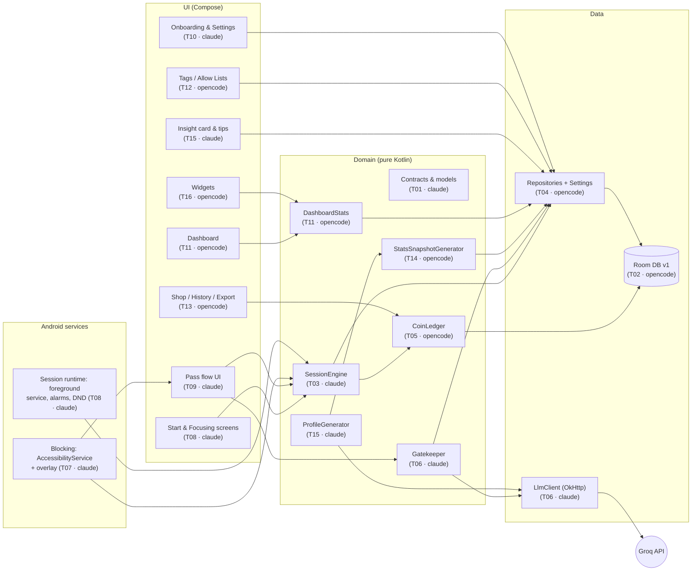
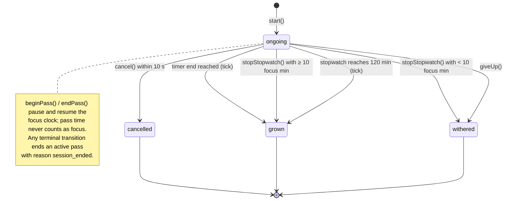
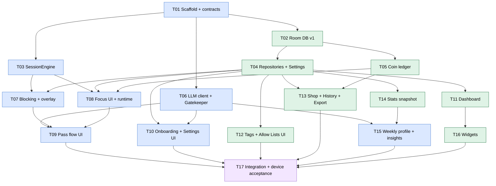

# Rootd v1 Implementation Plan

> **For agentic workers:** REQUIRED SUB-SKILL: Use superpowers:subagent-driven-development (recommended) or
> superpowers:executing-plans to implement this plan task-by-task. Steps use checkbox (`- [ ]`) syntax for tracking.
> **Before anything else read `AGENTS.md`.** Work only on tasks whose **Owner** is you.

**Goal:** Build Rootd v1 — a personal Android focus app (timer/stopwatch, tree grows/withers, app blocking with an
overlay, LLM gatekeeper for mid-session passes, coins/shop, dashboard, weekly LLM insights, widgets).

**Architecture:** Single Android app module (`:app`), package-by-feature. Pure-Kotlin domain logic
(session engine, coin maths, gatekeeper rules, stats) sits behind interfaces defined in Task 01 and is unit-tested
on the JVM with in-memory implementations. Android-specific parts (Room, DataStore, AccessibilityService,
overlay, widgets) implement or consume those interfaces. Two agents build in parallel in separate git worktrees,
split by package ownership so they never edit the same file.

**Tech Stack:** Kotlin 2.x, Jetpack Compose (Material 3), Room (KSP), DataStore Preferences, Android Keystore,
kotlinx.coroutines, kotlinx.serialization, OkHttp, Jetpack Glance (widgets), JUnit 4, kotlinx-coroutines-test,
Turbine, Robolectric, Gradle 9.3.1 wrapper.

**Spec:** `docs/superpowers/specs/2026-10-21-rootd-design.md` (product) and `docs/data-model.md` (data —
source of truth). Research only: `docs/forest-re-notes.md`.

---

## 0. How to use this plan

1. Find the next task where **Owner** = you and every task in **Depends on** is merged to `main`.
2. Create your branch from fresh `main` in **your own worktree** (`../Forest-claude` or `../Forest-opencode`):
   `git fetch origin && git switch -c <Branch> origin/main`.
3. Read the task's **Interfaces**, **Acceptance criteria** and **Tests** before coding. Read the spec/data-model
   sections the task cites.
4. Follow the steps (TDD: failing test → implement → passing test → commit).
5. Touch only files listed under **Files**. Need something outside? Stop and write a note in the PR; don't edit it.
6. Done = every acceptance criterion met + `./gradlew :app:testDebugUnitTest :app:lintDebug` green + task box
   ticked in §6 with a 2–3 line handoff note. Push the branch and open a PR to `main`. **Never merge it yourself.**
7. The other agent reviews the PR (checklist in §8); the owner merges.

---

## 1. Global Constraints

Every task implicitly includes all of these.

- **Platform:** Android only. `minSdk 29`, `targetSdk 36`, `compileSdk 36`. Device of record: Moto g54 5G.
- **Build:** Gradle wrapper **9.3.1** (already cached at `~/.gradle/wrapper/dists/gradle-9.3.1-bin`). Latest
  stable AGP and Kotlin compatible with Gradle 9.3.1, pinned in `gradle/libs.versions.toml` (Task 01 decides the
  exact numbers; nobody else changes them without a PR note).
- **App id / package:** `com.krunal.rootd`. App name: **Rootd**.
- **Data:** exactly as `docs/data-model.md` (schema version 1). Enum DB values, column names, JSON field names
  copied verbatim from it. Change the doc first if anything must change.
- **Time:** all logic takes `java.time.Clock` by injection; no `System.currentTimeMillis()` / `Instant.now()`
  without a clock in logic code. Day boundaries = device local zone (`clock.zone`).
- **LLM:** OpenAI-compatible Chat Completions. Default base URL `https://api.groq.com/openai/v1`. Gatekeeper
  timeout default **4000 ms**. Only `LlmClient` knows HTTP/provider details.
- **Hard numbers from the spec** (never change in code without changing the spec):
  timer 10–120 min step 5 · stopwatch cap 120 min · stopwatch withered if `< 10` focus min · cancel window
  **10 s** · give-up confirm countdown **5 s** · max **2 passes** and **4 requests** per session · pass length
  **1–5 min** · deny/accepted-push_back cooldown **3 min** · one appeal per push_back · fallback pass **2 min**,
  once per session · pass cost **2 coins per started pass-minute** · no-pass bonus **20 %** (floor) ·
  message ≤ **140** chars · profile text ≤ **120** words · weekly profile needs ≥ **5** finished sessions.
- **Privacy:** only the fields in data-model §12 leave the phone. API key never logged/committed/exported.
- **Legal:** no Forest code, art, sounds, strings or name. Placeholder art is drawn in Compose (original).
- **Tests:** JVM unit tests by default (`app/src/test`); Robolectric for Room/DataStore/Android-framework logic;
  instrumented tests (`app/src/androidTest`) only where a task says so.
- **Style:** match surrounding code; no reformatting of untouched files; one responsibility per file.

---

## 2. Architecture

### 2.1 Component map and ownership



### 2.2 Package layout (who owns what)

Base package `com.krunal.rootd` under `app/src/main/kotlin/`. Tests mirror it under `app/src/test/kotlin/`.

| Package | Contents | Owner |
|---|---|---|
| `domain/model` | Enums + data classes (contracts) | T01 claude (frozen after T01; changes need both agents' review) |
| `domain/repo` | Repository interfaces | T01 claude (frozen) |
| `domain/llm` | `LlmClient` interface + result types | T01 claude (frozen) |
| `data/memory` | In-memory repository implementations (used as test fakes and early bindings) | T01 claude |
| `data/db` | Room entities, DAOs, converters, `RootdDatabase`, seeds | opencode (T02) |
| `data/repo` | Room/DataStore-backed repositories, settings, key crypto | opencode (T04) |
| `coins` | Coin formula + `CoinLedger` implementation | opencode (T05) |
| `stats` | Dashboard stats queries | opencode (T11) |
| `insights/snapshot` | Weekly stats snapshot generator + JSON models | opencode (T14) |
| `insights/profile` | Profile generation (LLM), tip selection | claude (T15) |
| `session` | `SessionEngine`, session runtime service, alarms, DND, sound | claude (T03, T08) |
| `blocking` | Accessibility service, foreground monitor, allow-set cache, overlay | claude (T07) |
| `gatekeeper` | Gatekeeper rules, prompts, response validation | claude (T06) |
| `llm` | `OpenAiCompatibleLlmClient` (OkHttp) | claude (T06) |
| `ui/focus`, `ui/pass`, `ui/settings`, `ui/onboarding`, `ui/insights` | Claude's screens | claude |
| `ui/dashboard`, `ui/catalog`, `ui/shop`, `ui/history`, `widget` | opencode's screens/widgets | opencode |
| `ui/nav`, `ui/theme`, `app` (`RootdApp`, `AppContainer`) | Shell, created in T01 | claude (T01); others only fill their own `*Module.kt` (§2.4) |

### 2.3 Session lifecycle (from data-model §3.3)



### 2.4 Dependency wiring (no DI framework)

Manual DI. `RootdApp : Application` owns one `AppContainer`. To keep the two agents out of each other's files,
`AppContainer` composes two modules:

```kotlin
class AppContainer(context: Context, clock: Clock) {
    val data: DataModule = DataModule(context, clock)        // file data/DataModule.kt  — opencode fills (T04, T05)
    val features: FeatureModule = FeatureModule(context, clock, data) // file app/FeatureModule.kt — claude fills
}
```
T01 creates both files with every property bound to the `data/memory` implementations. T04/T05 replace
bindings **inside `DataModule.kt` only**; claude tasks edit **`FeatureModule.kt` only**.

### 2.5 Gatekeeper sequence ("I need it")

```mermaid
sequenceDiagram
  actor U as User
  participant OV as Overlay (T07/T09)
  participant GK as Gatekeeper (T06)
  participant DB as Repos (T04)
  participant L as LlmClient → Groq
  participant SE as SessionEngine (T03)

  U->>OV: opens blocked app → overlay → "I need it"
  OV->>GK: availability(sessionId)
  GK-->>OV: Available | Cooldown(until) | LimitReached
  U->>OV: reason text (typed or voice)
  OV->>GK: request(app, reason)
  GK->>DB: session, passes, today's count, latest profile
  GK->>L: chatJson(gatekeeperModel, system, user, 4000 ms)
  alt LLM ok + valid JSON
    L-->>GK: {verdict, minutes, message, reason_category}
  else timeout / error / invalid JSON
    GK->>GK: fallback rule (one 2-min allow per session, else deny)
  end
  GK->>DB: insert PassRequest, update counters
  GK-->>OV: GatekeeperDecision
  alt allow
    U->>OV: "Start pass"
    OV->>SE: beginPass(requestId)
    Note over OV: countdown bubble; on expiry → SE.endPass(expired) → overlay
  else push_back
    U->>OV: accept → GK.acceptPushBack()  /  appeal → GK.appeal()
  else deny
    OV-->>U: message, button locked 3 min
  end
```

---

## 3. Task map

### 3.1 Dependency graph



### 3.2 Waves (what runs in parallel)

Within a wave, the claude column and the opencode column run at the same time (disjoint files). Inside one
column, do tasks top to bottom.

| Wave | claude (`../Forest-claude`) | opencode (`../Forest-opencode`) | Gate to next wave |
|---|---|---|---|
| 0 | **T01** Scaffold + contracts | — (review T01 PR) | T01 merged |
| 1 | T03 SessionEngine → T06 LLM + Gatekeeper | T02 Room DB → T04 Repos → T05 Coins | T02–T06 merged |
| 2 | T07 Blocking → T08 Focus UI + runtime | T11 Dashboard → T14 Snapshot | each task's deps merged |
| 3 | T10 Onboarding/Settings → T09 Pass flow | T12 Tags/Allow Lists → T13 Shop/History | — |
| 4 | T15 Weekly profile | T16 Widgets | all merged |
| 5 | **T17** Integration + device acceptance (claude drives, owner tests on phone; opencode reviews) | | v1 done |

### 3.3 Task index

| # | Task | Owner | Branch | Depends on | Size |
|---|---|---|---|---|---|
| T01 | Scaffold, build, shared contracts, in-memory impls | claude | `task/01-scaffold-contracts` | — | M |
| T02 | Room database v1 (entities, DAOs, seeds, index) | opencode | `task/02-room-db` | T01 | M |
| T03 | SessionEngine (state machine, timing, recovery) | claude | `task/03-session-engine` | T01 | M |
| T04 | Repositories over Room + Settings/DataStore + key crypto | opencode | `task/04-repositories-settings` | T02 | M |
| T05 | Coin formula + CoinLedger | opencode | `task/05-coin-ledger` | T02 | S |
| T06 | LLM client + Gatekeeper rules | claude | `task/06-llm-gatekeeper` | T01 | L |
| T07 | Blocking (accessibility, allow set, overlay shell) | claude | `task/07-blocking` | T03, T04 | L |
| T08 | Focus UI + session runtime (service, alarms, DND, sound, tree art) | claude | `task/08-focus-runtime` | T03, T04, T05 | L |
| T09 | Pass flow UI (reason, verdicts, appeal, countdown) | claude | `task/09-pass-flow` | T06, T07, T08 | M |
| T10 | Onboarding + Settings UI (+ latency diagnostics) | claude | `task/10-onboarding-settings` | T04, T06 | M |
| T11 | Dashboard stats + UI (day/week/month/year, streak) | opencode | `task/11-dashboard` | T04 | L |
| T12 | Tags, Allow Lists, Always-Allowed (seed + UI) | opencode | `task/12-catalog` | T04 | M |
| T13 | Shop, History/Session detail, Export | opencode | `task/13-shop-history-export` | T04, T05 | M |
| T14 | Weekly stats snapshot generator | opencode | `task/14-stats-snapshot` | T04 | M |
| T15 | Weekly profile (LLM), insight card, pre-session tip | claude | `task/15-weekly-profile` | T06, T14 | M |
| T16 | Home-screen widgets (Glance) | opencode | `task/16-widgets` | T11 | S |
| T17 | Integration + on-device acceptance + release build | claude (+ owner) | `task/17-integration` | all | M |

Size: S ≈ < 300 lines of production code, M ≈ 300–800, L ≈ > 800.

---

## 4. Review Focus

Failure modes the spec implies but no feature test naturally covers. Each has a pinned test in the owning task.

1. **Process death / reboot during a session or during an active pass** → on restart the session resumes with
   correct remaining time; pass time is not counted as focus; a pass that expired while dead is closed as
   `expired` at its expiry time. *Pinned: T03 `recover_*` tests; T08 device check.*
2. **Clock jumps, time-zone change, midnight crossing** → elapsed focus is never negative or > wall time; a
   session belongs to its `started_local_date`; streak and daily totals don't double-count or drop a session.
   *Pinned: T03 `elapsed_clockMovedBackwards_isClampedToZero`; T11 `day_sessionCrossingMidnight_countsOnStartDate`.*
3. **LLM misbehaves** (prose around JSON, unknown verdict, minutes 9, 600-char message, HTTP 429, hang) →
   validated or fallback; never a crash, never a pass > 5 min, never more than the limits. *Pinned: T06
   `parse_*` and `request_*Fallback*` tests.*
4. **Things that must never be blocked** — Rootd itself, launcher, System UI, the active keyboard, always-allowed
   apps — and nothing is blocked when no session is ongoing. *Pinned: T07 `shouldBlock_*` tests.*
5. **Double or racing endings** (give up while a pass is active, timer ends during a pass, `settleSession`
   called twice) → one terminal state, pass closed `session_ended`, coins written exactly once. *Pinned: T03
   `giveUp_duringPass_*`, T05 `settleSession_isIdempotent`.*

---

## 5. Tasks

Conventions in every task: `./gradlew` means the project wrapper. "Run unit tests" =
`./gradlew :app:testDebugUnitTest --tests '<pattern>'`. Commit messages: `feat(<area>): …`, `test(<area>): …`,
ending with the agent's attribution line from AGENTS.md conventions.

---

### Task 01: Scaffold, build, shared contracts, in-memory implementations

**Owner:** claude · **Branch:** `task/01-scaffold-contracts` · **Depends on:** — · **Parallel with:** nothing
(everything waits for this) · **Size:** M

**Goal:** A buildable Compose app skeleton plus every shared Kotlin contract both agents code against, with
in-memory implementations so domain logic can be tested before Room exists.

**Files:**
- Create: `settings.gradle.kts`, `build.gradle.kts`, `gradle.properties`, `gradle/libs.versions.toml`,
  `gradle/wrapper/*`, `gradlew`, `gradlew.bat`, `app/build.gradle.kts`, `app/proguard-rules.pro`
- Create: `app/src/main/AndroidManifest.xml` (application + `MainActivity` only; later tasks add their own entries)
- Create: `app/src/main/kotlin/com/krunal/rootd/app/{RootdApp.kt, AppContainer.kt, FeatureModule.kt, MainActivity.kt}`
- Create: `app/src/main/kotlin/com/krunal/rootd/data/DataModule.kt`
- Create: `app/src/main/kotlin/com/krunal/rootd/domain/model/{Enums.kt, Session.kt, PassRequest.kt, Catalog.kt, Coins.kt, FocusProfile.kt, Settings.kt}`
- Create: `app/src/main/kotlin/com/krunal/rootd/domain/repo/{SessionRepository.kt, PassRequestRepository.kt, CatalogRepository.kt, AllowListRepository.kt, CoinLedger.kt, FocusProfileRepository.kt, SettingsRepository.kt}`
- Create: `app/src/main/kotlin/com/krunal/rootd/domain/llm/LlmClient.kt`
- Create: `app/src/main/kotlin/com/krunal/rootd/data/memory/*` (one `InMemory*` per repository interface)
- Create: `app/src/main/kotlin/com/krunal/rootd/ui/nav/{Routes.kt, RootdNavHost.kt}`, `ui/theme/*`,
  and one stub screen file per route (see AC-5)
- Create: `app/src/test/kotlin/com/krunal/rootd/testing/{FixedClock.kt, Builders.kt}`
- Create: `scripts/check.sh`

**Interfaces — Produces (frozen after merge; exact code):**

```kotlin
// domain/model/Enums.kt — every enum has `val db: String` and `companion object { fun fromDb(v: String): X }`
// fromDb throws IllegalArgumentException on unknown values. Values = data-model §2, in this order.
enum class SessionMode(val db: String) { TIMER("timer"), STOPWATCH("stopwatch") }
enum class SessionStatus(val db: String) { ONGOING("ongoing"), GROWN("grown"), WITHERED("withered"), CANCELLED("cancelled") }
enum class FailReason(val db: String) { GAVE_UP("gave_up"), STOPWATCH_TOO_SHORT("stopwatch_too_short") }
enum class Verdict(val db: String) { ALLOW("allow"), PUSH_BACK("push_back"), DENY("deny") }
enum class VerdictSource(val db: String) { LLM("llm"), FALLBACK("fallback") }
enum class ReasonCategory(val db: String) { WORK_MESSAGE("work_message"), PERSONAL_MESSAGE("personal_message"),
  CALL_OR_MEETING("call_or_meeting"), LOOKUP_INFO("lookup_info"), PAYMENT_OR_OTP("payment_or_otp"),
  ENTERTAINMENT("entertainment"), JUST_CHECKING("just_checking"), OTHER("other") }
enum class PassEndReason(val db: String) { EXPIRED("expired"), RETURNED_TO_ROOTD("returned_to_rootd"), SESSION_ENDED("session_ended") }
enum class CoinKind(val db: String) { SESSION_REWARD("session_reward"), NO_PASS_BONUS("no_pass_bonus"), PASS_COST("pass_cost"), SPECIES_UNLOCK("species_unlock") }
enum class AlwaysAllowedReason(val db: String) { PHONE("phone"), MAPS("maps"), OTP("otp"), USER("user") }

// domain/model/Session.kt — mirrors data-model §3 (ms timestamps → Instant, local dates → LocalDate)
data class Session(
  val id: Long = 0, val mode: SessionMode, val plannedMinutes: Int?, val startedAt: Instant,
  val startedLocalDate: LocalDate, val endedAt: Instant? = null, val status: SessionStatus = SessionStatus.ONGOING,
  val failReason: FailReason? = null, val pausedSeconds: Long = 0, val pauseStartedAt: Instant? = null,
  val focusSeconds: Long = 0, val speciesId: Long, val tagId: Long?, val allowListId: Long?, val goalNote: String?,
  val tookBreak: Boolean = false, val passCount: Int = 0, val requestCount: Int = 0, val lastDeniedAt: Instant? = null)

// domain/model/PassRequest.kt — mirrors data-model §4
data class PassRequest(
  val id: Long = 0, val sessionId: Long, val appPackage: String, val appLabel: String, val askedAt: Instant,
  val askedLocalDate: LocalDate, val reasonText: String, val reasonCategory: ReasonCategory = ReasonCategory.OTHER,
  val wasAppeal: Boolean = false, val originalRequestId: Long? = null, val verdict: Verdict,
  val verdictSource: VerdictSource, val llmMessage: String?, val llmModel: String?, val llmLatencyMs: Long?,
  val grantedMinutes: Int = 0, val passStartedAt: Instant? = null, val passEndedAt: Instant? = null,
  val passEndReason: PassEndReason? = null, val usedSeconds: Long = 0, val returnedBeforeExpiry: Boolean? = null)

// domain/model/Catalog.kt
data class Tag(val id: Long = 0, val name: String, val colorArgb: Int, val archived: Boolean = false, val createdAt: Instant)
data class Species(val id: Long, val key: String, val name: String, val priceCoins: Int, val unlockedAt: Instant?, val sortOrder: Int)
data class AllowList(val id: Long = 0, val name: String, val isDefault: Boolean, val createdAt: Instant)
data class AlwaysAllowedApp(val appPackage: String, val reason: AlwaysAllowedReason, val isSystemDefault: Boolean)
data class AppRef(val packageName: String, val label: String)

// domain/model/Coins.kt
data class CoinTransaction(val id: Long = 0, val at: Instant, val amount: Int, val kind: CoinKind,
  val sessionId: Long?, val speciesId: Long?, val note: String?)

// domain/model/FocusProfile.kt — JSON columns stay as raw String here; parsing lives in T14/T15
data class FocusProfile(val id: Long = 0, val generatedAt: Instant, val periodStart: LocalDate, val periodEnd: LocalDate,
  val profileText: String, val insightsJson: String, val statsSnapshotJson: String, val llmModel: String, val seenAt: Instant?)

// domain/model/Settings.kt — data-model §9 minus the API key
data class Settings(
  val llmBaseUrl: String = "https://api.groq.com/openai/v1", val gatekeeperModel: String = "",
  val profileModel: String = "", val llmTimeoutMs: Int = 4000, val defaultMode: SessionMode = SessionMode.TIMER,
  val defaultMinutes: Int = 25, val defaultSpeciesId: Long? = null, val defaultAllowListId: Long? = null,
  val dndEnabled: Boolean = false, val dndPreviousFilter: Int = -1, val ambientSound: String = "none",
  val onboardingDone: Boolean = false)
```

```kotlin
// domain/repo/*.kt
interface SessionRepository {
  suspend fun insert(session: Session): Long           // throws IllegalStateException if an ongoing session exists
  suspend fun update(session: Session)
  suspend fun get(id: Long): Session?
  suspend fun getOngoing(): Session?
  fun observeOngoing(): Flow<Session?>
  fun observeBetween(startDate: LocalDate, endDateInclusive: LocalDate): Flow<List<Session>> // by startedLocalDate, ordered by startedAt
  suspend fun countFinished(): Int                      // status in (grown, withered)
  suspend fun earliestStartDate(): LocalDate?
}
interface PassRequestRepository {
  suspend fun insert(request: PassRequest): Long
  suspend fun update(request: PassRequest)
  suspend fun get(id: Long): PassRequest?
  suspend fun forSession(sessionId: Long): List<PassRequest>          // ordered by askedAt
  suspend fun activePass(sessionId: Long): PassRequest?               // passStartedAt != null && passEndedAt == null
  suspend fun countNonAppealForAppOn(appPackage: String, date: LocalDate): Int
  suspend fun between(startDate: LocalDate, endDateInclusive: LocalDate): List<PassRequest> // by askedLocalDate
}
interface CatalogRepository {
  fun observeTags(includeArchived: Boolean = false): Flow<List<Tag>>
  suspend fun getTag(id: Long): Tag?
  suspend fun upsertTag(tag: Tag): Long                 // throws IllegalArgumentException on duplicate active name (case-insensitive)
  suspend fun setTagArchived(id: Long, archived: Boolean)
  fun observeSpecies(): Flow<List<Species>>             // ordered by sortOrder
  suspend fun getSpecies(id: Long): Species?
  suspend fun markSpeciesUnlocked(id: Long, at: Instant)
}
interface AllowListRepository {
  fun observeAllowLists(): Flow<List<AllowList>>
  suspend fun create(name: String): Long
  suspend fun rename(id: Long, name: String)
  suspend fun delete(id: Long): Boolean                 // false if used by the ongoing session or it's the last list
  suspend fun setDefault(id: Long)
  suspend fun getDefault(): AllowList
  suspend fun packagesFor(allowListId: Long): Set<String>
  suspend fun setPackages(allowListId: Long, packages: Set<String>)
  fun observeAlwaysAllowed(): Flow<List<AlwaysAllowedApp>>
  suspend fun alwaysAllowedPackages(): Set<String>
  suspend fun addAlwaysAllowed(app: AlwaysAllowedApp)   // ignore if already present
  suspend fun removeAlwaysAllowed(appPackage: String): Boolean // false if isSystemDefault
}
interface CoinLedger {
  fun observeBalance(): Flow<Int>
  suspend fun balance(): Int
  suspend fun settleSession(sessionId: Long)            // data-model §6.3; idempotent; no-op for cancelled
  suspend fun unlockSpecies(speciesId: Long): UnlockResult
  fun observeTransactions(): Flow<List<CoinTransaction>> // newest first
  suspend fun forSession(sessionId: Long): List<CoinTransaction>
}
enum class UnlockResult { UNLOCKED, ALREADY_UNLOCKED, NOT_ENOUGH_COINS }
interface FocusProfileRepository {
  suspend fun latest(): FocusProfile?
  fun observeLatest(): Flow<FocusProfile?>
  suspend fun insert(profile: FocusProfile): Long
  suspend fun markSeen(id: Long, at: Instant)
}
interface SettingsRepository {
  val settings: Flow<Settings>
  suspend fun current(): Settings
  suspend fun update(transform: (Settings) -> Settings)
  suspend fun apiKey(): String                          // "" if unset
  suspend fun setApiKey(key: String)
}
```

```kotlin
// domain/llm/LlmClient.kt
interface LlmClient {
  /** One chat completion asking for a JSON object. Never throws for network/HTTP problems — returns Failure. */
  suspend fun chatJson(model: String, system: String, user: String, timeoutMs: Long): LlmResult
}
sealed interface LlmResult {
  data class Ok(val content: String, val latencyMs: Long, val model: String) : LlmResult
  data class Failure(val kind: Kind, val detail: String) : LlmResult {
    enum class Kind { NO_API_KEY, NETWORK, TIMEOUT, HTTP, BAD_RESPONSE }
  }
}
```

**Routes (stub screens)** — `ui/nav/Routes.kt` defines `sealed class Route(val path: String)` with:
`Onboarding`, `Start`, `Focusing`, `SessionResult(sessionId)`, `Dashboard`, `SessionDetail(sessionId)`,
`Shop`, `Tags`, `AllowLists`, `AllowListEdit(id)`, `AlwaysAllowed`, `Settings`, `WeeklyInsights`.
Each route's composable lives in its own file in the owner's package (e.g. `ui/dashboard/DashboardScreen.kt`)
and T01 creates it as a stub `Text("<Route> — TODO T<nn>")`. Owners replace only their own stub file.

**Acceptance criteria**
- AC-1 `./gradlew :app:assembleDebug :app:testDebugUnitTest :app:lintDebug` succeeds from a clean clone.
- AC-2 Versions pinned in `gradle/libs.versions.toml`; wrapper = 9.3.1; `minSdk 29`, `targetSdk 36`, `compileSdk 36`; Room schema export dir `app/schemas` configured (`exportSchema = true`) even though Room code comes in T02.
- AC-3 All contracts above exist with exactly these names/signatures.
- AC-4 Every `InMemory*` implementation honours the interface comments (ongoing uniqueness, archived filtering, system-default protection, etc.) and is used by `DataModule` bindings.
- AC-5 App launches on the device to a bottom-navigation shell (Start · Dashboard · Shop · Settings) with stub screens; all routes navigable.
- AC-6 `scripts/check.sh` runs AC-1's command and exits non-zero on failure.
- AC-7 `FixedClock` (mutable, advance by Duration, settable zone) and `Builders.kt` (`aSession(...)`, `aPassRequest(...)` with sensible defaults) exist for all later tests.

**Tests** (`app/src/test/kotlin/com/krunal/rootd/`)
- `domain/model/EnumsTest`: for every enum, `fromDb(x.db) == x` for all entries; `fromDb("nope")` throws.
- `data/memory/InMemorySessionRepositoryTest`: `insert_secondOngoing_throws`; `observeBetween_filtersByStartedLocalDate`.
- `data/memory/InMemoryAllowListRepositoryTest`: `removeAlwaysAllowed_systemDefault_returnsFalse`; `delete_lastList_returnsFalse`.
- `data/memory/InMemoryCatalogRepositoryTest`: `upsertTag_duplicateActiveNameIgnoringCase_throws`.

**Steps**
- [ ] 1. Generate the Gradle project (Kotlin DSL, version catalog, Compose, KSP + Room plugins declared but unused, kotlinx.serialization plugin). Run `./gradlew :app:assembleDebug` → BUILD SUCCESSFUL.
- [ ] 2. Write `EnumsTest`; run → fails (no enums). Add `Enums.kt`; run → passes. Commit.
- [ ] 3. Add model data classes and repo/LLM interfaces exactly as above. Compile. Commit.
- [ ] 4. Write the `InMemory*` tests; run → fail. Implement `data/memory/*` with `MutableStateFlow`-backed state; run → pass. Commit.
- [ ] 5. Add `FixedClock`, `Builders.kt`. Commit.
- [ ] 6. Add `RootdApp`, `AppContainer`, `DataModule` (bound to in-memory), `FeatureModule` (empty), nav shell + stub screens, theme. Install on device; navigate every route. Commit.
- [ ] 7. Add `scripts/check.sh`; run it → exit 0. Commit, push, open PR.

---

### Task 02: Room database v1

**Owner:** opencode · **Branch:** `task/02-room-db` · **Depends on:** T01 · **Parallel with:** T03, T06 · **Size:** M

**Goal:** The Room schema exactly as `docs/data-model.md` §3–§8, with converters, DAOs, seeds and the partial
unique index.

**Files:**
- Create: `app/src/main/kotlin/com/krunal/rootd/data/db/{RootdDatabase.kt, Converters.kt, Seed.kt}`
- Create: `data/db/entity/{SessionEntity.kt, PassRequestEntity.kt, TagEntity.kt, SpeciesEntity.kt, AllowListEntity.kt, AllowListAppEntity.kt, AlwaysAllowedAppEntity.kt, CoinTransactionEntity.kt, FocusProfileEntity.kt}`
- Create: `data/db/dao/{SessionDao.kt, PassRequestDao.kt, CatalogDao.kt, AllowListDao.kt, CoinDao.kt, FocusProfileDao.kt}`
- Create: `app/schemas/com.krunal.rootd.data.db.RootdDatabase/1.json` (generated, committed)
- Test: `app/src/test/kotlin/com/krunal/rootd/data/db/*` (Robolectric, in-memory Room)

**Interfaces**
- Consumes: enums from T01 (`db` / `fromDb`).
- Produces: `RootdDatabase.create(context: Context): RootdDatabase` (file DB name `rootd.db`) and
  `RootdDatabase.inMemory(context: Context): RootdDatabase` (tests); DAOs with suspend/Flow queries that T04/T05
  need — at minimum the queries backing every repository method in T01 plus
  `CoinDao.sum(): Int?`, `CoinDao.observeSum(): Flow<Int?>`, `CoinDao.forSession(sessionId): List<CoinTransactionEntity>`,
  and `@Transaction`-friendly insert methods. Entity↔model mappers `toModel()` / `toEntity()` live next to each entity.

**Acceptance criteria**
- AC-1 Tables, columns, types, nullability, defaults, FKs (with the stated `ON DELETE` actions) and indexes match data-model §3–§8 exactly; `PRAGMA foreign_keys` on.
- AC-2 Partial unique index created via `RoomDatabase.Callback` in `onCreate` **and** `onOpen` with the exact SQL from data-model §8.
- AC-3 Seeds on first create (data-model §5): tags `study, work, read, exercise` with distinct colors; species `oak` (id 1, price 0, unlocked), `pine` (id 2, 0, unlocked), `birch` 300, `maple` 500, `cherry` 800, `bamboo` 1000, `baobab` 1500 with `sort_order` in that order; allow list "Default" with `is_default = 1`. Always-allowed apps are **not** seeded here (T12 resolves them on device).
- AC-4 Timestamps stored as epoch ms, local dates as `yyyy-MM-dd`, enums as their `db` string, booleans 0/1.
- AC-5 Schema JSON exported to `app/schemas/.../1.json` and committed.
- AC-6 No `fallbackToDestructiveMigration` anywhere.

**Tests**
- `RootdDatabaseSeedTest`: `create_seedsSevenSpeciesWithStartersUnlocked`; `create_seedsOneDefaultAllowList`; `create_seedsFourTags`.
- `SessionDaoTest`: `insert_secondOngoing_violatesPartialUniqueIndex` (expect `SQLiteConstraintException`); `twoFinishedSessions_allowed`; `deleteTag_setsSessionTagNull`; `deleteAllowList_setsSessionAllowListNull`.
- `PassRequestDaoTest`: `deleteSession_cascadesPassRequests`; `countNonAppealForAppOn_ignoresAppealsAndOtherDates`.
- `ConvertersTest`: round-trip `Instant`, `LocalDate`, every enum.
- `CoinDaoTest`: `sum_emptyLedger_isNull`; `sum_mixedAmounts`.

**Steps**
- [ ] 1. Write `ConvertersTest`; fail; implement `Converters`; pass; commit.
- [ ] 2. Write `RootdDatabaseSeedTest` + `SessionDaoTest`; fail; implement entities, DAOs, database, callback (index + seeds); pass; commit.
- [ ] 3. Write remaining DAO tests; fail; complete DAOs; pass; commit.
- [ ] 4. `./gradlew :app:kspDebugKotlin` → verify `app/schemas/.../1.json`; commit it. Run `scripts/check.sh`. Push, PR.

---

### Task 03: SessionEngine

**Owner:** claude · **Branch:** `task/03-session-engine` · **Depends on:** T01 · **Parallel with:** T02, T04, T05 · **Size:** M

**Goal:** All session rules (design §4.1, data-model §3) as pure Kotlin over the T01 interfaces: start, cancel,
give up, stopwatch stop, timer/stopwatch completion, pass pause/resume, restart recovery.

**Files:**
- Create: `app/src/main/kotlin/com/krunal/rootd/session/{SessionEngine.kt, SessionTiming.kt, StartRequest.kt}`
- Test: `app/src/test/kotlin/com/krunal/rootd/session/{SessionEngineTest.kt, SessionTimingTest.kt}`

**Interfaces**
- Consumes: `SessionRepository`, `PassRequestRepository`, `CoinLedger`, `java.time.Clock` (T01; tests use `InMemory*` + `FixedClock`).
- Produces:
```kotlin
data class StartRequest(val mode: SessionMode, val plannedMinutes: Int?, val speciesId: Long,
                        val tagId: Long?, val allowListId: Long?, val goalNote: String?)
object SessionTiming {
  const val CANCEL_WINDOW_SECONDS = 10L; const val STOPWATCH_CAP_MINUTES = 120; const val STOPWATCH_MIN_MINUTES = 10
  fun elapsedFocus(s: Session, now: Instant): Duration      // data-model §3.2, clamped to [0, now - startedAt]
  fun timerEnd(s: Session, now: Instant): Instant?           // null for stopwatch; includes current pause
  fun growthStage(s: Session, now: Instant): GrowthStage     // SEED <25%, SPROUT <50%, SAPLING <75%, TREE
}
enum class GrowthStage { SEED, SPROUT, SAPLING, TREE }
class SessionEngine(sessions: SessionRepository, passes: PassRequestRepository, coins: CoinLedger, clock: Clock) {
  suspend fun start(request: StartRequest): Session          // IllegalStateException if one is ongoing; validates minutes 10..120 step 5 for TIMER, null for STOPWATCH
  suspend fun canCancel(): Boolean                           // ongoing && now - startedAt < 10 s
  suspend fun cancel(): Boolean                              // false (no change) outside the window
  suspend fun giveUp(): Session                              // → withered(gave_up)
  suspend fun stopStopwatch(): Session                       // → grown if ≥10 focus min else withered(stopwatch_too_short)
  suspend fun tick(): Session?                               // completes a due timer/stopwatch-cap; closes an expired pass; returns ongoing or just-finished session
  suspend fun recover(): Session?                            // on process start: = tick() semantics + consistency repair
  suspend fun beginPass(passRequestId: Long)                 // sets pauseStartedAt, passStartedAt, tookBreak, passCount++
  suspend fun endPass(reason: PassEndReason)                 // adds pause to pausedSeconds, sets passEndedAt/usedSeconds/returnedBeforeExpiry
  fun observeOngoing(): Flow<Session?>
}
```
Every terminal transition: sets `endedAt`, final `focusSeconds = elapsedFocus`, closes any active pass with
`SESSION_ENDED`, then calls `coins.settleSession(id)` for `GROWN`/`WITHERED` (not `CANCELLED`).

**Acceptance criteria**
- AC-1 Every transition in §2.3's diagram works; terminal sessions never change status again.
- AC-2 Timer completes exactly at `startedAt + planned + paused` (inclusive); completion time recorded as that instant, not "now", when `tick()` runs late.
- AC-3 Stopwatch: auto-grows at 120 focus min; manual stop < 10 min → withered `stopwatch_too_short`.
- AC-4 Cancel only within 10 s of `startedAt` (focus time, not pass time — passes can't start in 10 s anyway); cancelled sessions get no coin calls.
- AC-5 Pass pause: focus clock frozen while `pauseStartedAt != null`; `endPass` caps `usedSeconds` at `grantedMinutes*60`; `returnedBeforeExpiry = (reason == RETURNED_TO_ROOTD)`.
- AC-6 `tick()`/`recover()` close a pass whose expiry (`passStartedAt + granted`) has passed as `EXPIRED` **at the expiry instant** (pause accounting uses expiry, not now).
- AC-7 Elapsed focus never negative and never exceeds wall time since start, even if the clock moves backwards.

**Tests** (`SessionEngineTest`, `FixedClock` at `2026-10-21T09:00:00Z`, zone `Asia/Kolkata`)
```kotlin
@Test fun start_timer25_createsOngoingWithLocalDate()          // startedLocalDate == 2026-10-21, status ONGOING
@Test fun start_whileOngoing_throws()
@Test fun start_timerMinutes7_or_33_throwsIllegalArgument()
@Test fun cancel_at9s_cancelled_noCoinCall()                   // spy ledger: settleSession never called
@Test fun cancel_at11s_returnsFalse_staysOngoing()
@Test fun tick_at25min_timerGrown_endedAtExactlyPlannedEnd()
@Test fun tick_runningLate_endedAtIsPlannedEndNotNow()          // clock at 25m+3h → endedAt = start+25m
@Test fun pass_2min_shiftsTimerEndBy2min()
@Test fun stopStopwatch_at9m59s_witheredTooShort()
@Test fun stopStopwatch_at10m_grown()
@Test fun tick_stopwatchAt120min_grown()
@Test fun giveUp_duringPass_closesPassSessionEnded_andSettlesOnce()   // Review Focus 5
@Test fun tick_timerEndsDuringPass_closesPassSessionEnded()           // Review Focus 5
@Test fun endPass_usedSecondsCappedAtGranted()
@Test fun recover_afterProcessDeath_passExpiredWhileDead_closedAtExpiry() // Review Focus 1
@Test fun recover_afterProcessDeath_timerAlreadyDue_grownAtPlannedEnd()   // Review Focus 1
@Test fun elapsed_clockMovedBackwards_isClampedToZero()                   // Review Focus 2
```
`SessionTimingTest`: `growthStage_boundaries_24_25_49_50_74_75_percent`; `timerEnd_stopwatch_isNull`.

**Steps**
- [ ] 1. Write `SessionTimingTest`; fail; implement `SessionTiming`; pass; commit.
- [ ] 2. Write start/cancel tests; fail; implement `start`, `canCancel`, `cancel`; pass; commit.
- [ ] 3. Write completion tests (timer, stopwatch, give up); fail; implement `tick`, `stopStopwatch`, `giveUp` with a private `finish(status, reason, at)`; pass; commit.
- [ ] 4. Write pass + recovery tests; fail; implement `beginPass`, `endPass`, `recover`; pass; commit.
- [ ] 5. `scripts/check.sh`; push; PR.

---

### Task 04: Repositories over Room + Settings/DataStore + API-key crypto

**Owner:** opencode · **Branch:** `task/04-repositories-settings` · **Depends on:** T02 · **Parallel with:** T03, T06 · **Size:** M

**Goal:** Real implementations of every T01 repository interface (except `CoinLedger`, which is T05), plus
settings in DataStore and an encrypted API key, wired into `DataModule`.

**Files:**
- Create: `data/repo/{RoomSessionRepository.kt, RoomPassRequestRepository.kt, RoomCatalogRepository.kt, RoomAllowListRepository.kt, RoomFocusProfileRepository.kt}`
- Create: `data/repo/settings/{DataStoreSettingsRepository.kt, ApiKeyCipher.kt}`
- Modify: `data/DataModule.kt` (bindings only)
- Test: `app/src/test/kotlin/com/krunal/rootd/data/repo/*` (Robolectric)

**Interfaces**
- Consumes: T01 interfaces/models; T02 DAOs.
- Produces: implementations; `ApiKeyCipher(keyAlias = "rootd_llm_key")` with `encrypt(plain: String): String` (Base64 of IV‖ciphertext, AES-256-GCM, Android Keystore key) and `decrypt(stored: String): String`.

**Acceptance criteria**
- AC-1 Each repository satisfies the T01 interface contract (same behavior as the `InMemory*` version) — reuse the T01 in-memory test cases as a shared contract test where possible.
- AC-2 `SessionRepository.insert` translates the partial-index violation into `IllegalStateException`.
- AC-3 `AllowListRepository.delete` returns false for the list referenced by the ongoing session and for the last remaining list; `setDefault` keeps exactly one default and mirrors it into `Settings.defaultAllowListId`.
- AC-4 Settings keys and defaults exactly as data-model §9; `apiKey()` returns `""` when unset; the key is stored only encrypted (`ApiKeyCipher`), never in plain DataStore.
- AC-5 `DataModule` binds the Room/DataStore implementations; `InMemory*` remain only for tests.

**Tests**
- `RoomSessionRepositoryTest`: `insert_secondOngoing_throwsIllegalState`; `observeBetween_ordersByStartedAt`.
- `RoomAllowListRepositoryTest`: `delete_inUseByOngoing_false`; `setDefault_exactlyOneDefault`; `removeAlwaysAllowed_systemDefault_false`.
- `DataStoreSettingsRepositoryTest`: `defaults_matchDataModelSection9`; `update_persistsAcrossInstances`.
- `ApiKeyCipherTest` (Robolectric with a fake keystore provider, or JVM AES fallback injected): `roundTrip`; `storedValue_isNotPlaintext`.

**Steps**
- [ ] 1. Contract tests for sessions/passes; fail; implement; pass; commit.
- [ ] 2. Catalog + allow list tests; fail; implement; pass; commit.
- [ ] 3. Settings + cipher tests; fail; implement; pass; commit.
- [ ] 4. Swap bindings in `DataModule`; app runs on device; `scripts/check.sh`; push; PR.

---

### Task 05: Coin formula + CoinLedger

**Owner:** opencode · **Branch:** `task/05-coin-ledger` · **Depends on:** T02 · **Parallel with:** T03, T06 · **Size:** S

**Goal:** Data-model §6 exactly: reward formula, no-pass bonus, pass cost, clamping, unlocks — idempotent.

**Files:**
- Create: `coins/{CoinFormula.kt, RoomCoinLedger.kt}`
- Modify: `data/DataModule.kt` (bind `CoinLedger`)
- Test: `app/src/test/kotlin/com/krunal/rootd/coins/{CoinFormulaTest.kt, RoomCoinLedgerTest.kt}`

**Interfaces**
- Consumes: `CoinLedger` interface (T01), DAOs (T02).
- Produces: `object CoinFormula { fun base(focusMinutes: Int): Int; fun noPassBonus(base: Int): Int; fun passCost(usedSeconds: List<Long>): Int }` and `RoomCoinLedger(db, clock) : CoinLedger`.

**Acceptance criteria**
- AC-1 `base(m) = (m < 25 ? 1 : 4) + m/5 + (max(m−30,0)/30)·5` (integer division). Reference: 10→3, 25→9, 30→10, 45→13, 60→21, 90→32, 120→43; also 0→1, 24→5.
- AC-2 `noPassBonus = floor(base·0.2)`; written only if > 0 and `passCount == 0`.
- AC-3 `passCost = 2 · Σ ceil(usedSeconds/60)` over started passes; written as a negative `pass_cost`, also for withered sessions.
- AC-4 Balance never < 0: clamp per §6.2 with the original amount in `note`; no row when balance is already 0.
- AC-5 `settleSession` runs in one Room transaction and is idempotent (second call writes nothing); no rows for `cancelled` or `ongoing`.
- AC-6 `unlockSpecies`: `ALREADY_UNLOCKED` if unlocked; `NOT_ENOUGH_COINS` if balance < price (no rows); else writes `−price` and marks unlocked in one transaction.

**Tests**
```kotlin
@Test fun base_referenceValues() // assertEquals(listOf(1,5,3,9,10,13,21,32,43), listOf(0,24,10,25,30,45,60,90,120).map(CoinFormula::base))
@Test fun passCost_roundsEachPassUp() // passCost(listOf(61, 120)) == 2*(2+2) == 8
@Test fun settle_grown25_noPass_writesRewardAndBonus()   // +9, +1
@Test fun settle_grown60_onePass90s_writesRewardAndCost() // +21, −4, no bonus
@Test fun settle_withered_withPass_writesOnlyCost()
@Test fun settle_costExceedsBalance_clampsAndNotes()
@Test fun settle_cancelled_writesNothing()
@Test fun settleSession_isIdempotent()                   // Review Focus 5
@Test fun unlock_notEnough_noRows() ; @Test fun unlock_ok_debitsAndMarks()
```

**Steps**
- [ ] 1. `CoinFormulaTest`; fail; implement; pass; commit.
- [ ] 2. Ledger tests; fail; implement `RoomCoinLedger`; pass; commit.
- [ ] 3. Bind in `DataModule`; `scripts/check.sh`; push; PR.

---

### Task 06: LLM client + Gatekeeper rules

**Owner:** claude · **Branch:** `task/06-llm-gatekeeper` · **Depends on:** T01 · **Parallel with:** T02, T04, T05 · **Size:** L

**Goal:** The OpenAI-compatible HTTP client and the complete gatekeeper decision logic of design §5 and
data-model §4, §11.1, §12 — UI-free and fully unit-tested.

**Files:**
- Create: `llm/OpenAiCompatibleLlmClient.kt`
- Create: `gatekeeper/{Gatekeeper.kt, GatekeeperPrompt.kt, GatekeeperResponseParser.kt, GatekeeperModels.kt}`
- Modify: `app/FeatureModule.kt`
- Test: `llm/OpenAiCompatibleLlmClientTest.kt` (OkHttp `MockWebServer`), `gatekeeper/{GatekeeperTest.kt, GatekeeperResponseParserTest.kt, GatekeeperPromptTest.kt}`

**Interfaces**
- Consumes: `LlmClient`, `SettingsRepository`, `SessionRepository`, `PassRequestRepository`, `CatalogRepository` (tag name), `FocusProfileRepository`, `Clock`.
- Produces:
```kotlin
class OpenAiCompatibleLlmClient(settings: SettingsRepository, http: OkHttpClient) : LlmClient
  // POST {baseUrl}/chat/completions, Bearer apiKey, body {model, messages:[system,user], response_format:{type:"json_object"}, temperature:0.2}
sealed interface RequestAvailability { data object Available; data class Cooldown(val until: Instant); data object LimitReached; data object NoSession }
data class GatekeeperDecision(val requestId: Long, val verdict: Verdict, val minutes: Int, val message: String,
                              val source: VerdictSource, val canAppeal: Boolean)
class Gatekeeper(llm: LlmClient, settings: SettingsRepository, sessions: SessionRepository, passes: PassRequestRepository,
                 catalog: CatalogRepository, profiles: FocusProfileRepository, clock: Clock) {
  suspend fun availability(): RequestAvailability
  suspend fun request(app: AppRef, reasonText: String): GatekeeperDecision
  suspend fun appeal(pushBackRequestId: Long, reasonText: String): GatekeeperDecision
  suspend fun acceptPushBack(pushBackRequestId: Long)        // sets session.lastDeniedAt = now
}
object GatekeeperResponseParser { fun parse(raw: String, isAppeal: Boolean): ParsedVerdict? } // null = invalid → fallback
```

**Acceptance criteria**
- AC-1 Client: correct URL/headers/body; `Ok` with `content = choices[0].message.content`; maps no key → `NO_API_KEY`, `IOException` → `NETWORK`, timeout → `TIMEOUT`, non-2xx (incl. 429) → `HTTP`, missing content → `BAD_RESPONSE`. Never throws for these. Never logs the key or bodies.
- AC-2 Parser (§11.1): extracts the first `{…}` JSON object even with surrounding prose; unknown verdict → `null`; `minutes` clamped 1–5 for allow, 0 otherwise; message trimmed to 140 chars; unknown category → `OTHER`; on appeal `push_back` → `DENY`.
- AC-3 Limits enforced in code before calling the LLM: no ongoing session → `NoSession`; `requestCount ≥ 4` or `passCount ≥ 2` → `LimitReached`; within 3 min of `lastDeniedAt` → `Cooldown`. `request()` called while unavailable throws `IllegalStateException`.
- AC-4 Context sent = exactly data-model §12.1 (reason, app label, tag name, goal note, elapsed/remaining min, passes used/left, requests left, appeal flag + push_back message, today's count for the app, latest `profileText` or null). Asserted by capturing the `user` string in a fake `LlmClient`.
- AC-5 Fallback (§12.4) on any `Failure` or `null` parse: first time in a session and `passCount < 2` → allow 2 min `FALLBACK` with local message "Couldn't reach the gatekeeper — here's a 2-minute emergency pass."; otherwise deny `FALLBACK` "Couldn't reach the gatekeeper and your emergency pass is used. Back to focus."
- AC-6 Persistence: every request/appeal inserted as `PassRequest` (latency, model, category); non-appeal increments `session.requestCount`; deny sets `lastDeniedAt`; appeal links `originalRequestId`; only one appeal per push_back (second → `IllegalStateException`); `canAppeal = verdict == PUSH_BACK && !wasAppeal`.
- AC-7 System prompt (in `GatekeeperPrompt`) instructs: JSON only with the §11.1 fields; be brief, friendly, non-moralizing; reference the user's goal/patterns; prefer push_back for vague "just checking"; never grant more than asked or > 5 min.

**Tests**
- `OpenAiCompatibleLlmClientTest`: `ok_returnsContentAndLatency`; `http429_returnsHttpFailure`; `slowServer_returnsTimeout`; `noKey_returnsNoApiKey_withoutNetworkCall`.
- `GatekeeperResponseParserTest`: `proseAroundJson_parsed`; `minutes9_clampedTo5`; `allowWithMinutes0_clampedTo1`; `message600chars_truncatedTo140`; `unknownVerdict_null`; `unknownCategory_other`; `appealPushBack_becomesDeny`; `notJson_null`. *(Review Focus 3)*
- `GatekeeperTest`: `availability_noSession`; `availability_afterDeny_cooldownUntilPlus3min`; `availability_fourRequests_limitReached`; `request_llmAllow_persistsAndIncrements`; `request_timeout_firstFallbackAllow2min`; `request_secondFailure_fallbackDeny`; `request_contextContainsTodayCountAndProfile`; `appeal_twice_throws`; `acceptPushBack_setsCooldown`. *(Review Focus 3)*

**Steps**
- [ ] 1. Client tests with `MockWebServer`; fail; implement client; pass; commit.
- [ ] 2. Parser tests; fail; implement parser; pass; commit.
- [ ] 3. Gatekeeper availability/limits tests; fail; implement; pass; commit.
- [ ] 4. Request/fallback/appeal/context tests; fail; implement `Gatekeeper` + `GatekeeperPrompt`; pass; commit.
- [ ] 5. Wire in `FeatureModule`; `scripts/check.sh`; push; PR.

---

### Task 07: Blocking — accessibility monitor, allow set, overlay shell

**Owner:** claude · **Branch:** `task/07-blocking` · **Depends on:** T03, T04 · **Parallel with:** T11, T14 · **Size:** L

**Goal:** During an ongoing session, any non-allowed foreground app is covered by a full-screen overlay with
"Back to focus" and "I need it" (the latter opens T09's flow; until T09 it opens a placeholder).

**Files:**
- Create: `blocking/{RootdAccessibilityService.kt, ForegroundAppMonitor.kt, UsageStatsFallback.kt, AllowSetCache.kt, BlockPolicy.kt, BlockOverlay.kt, OverlayController.kt}`
- Create: `app/src/main/res/xml/accessibility_service_config.xml`
- Modify: `AndroidManifest.xml` (service, `SYSTEM_ALERT_WINDOW`, `PACKAGE_USAGE_STATS`, `QUERY_ALL_PACKAGES`), `app/FeatureModule.kt`
- Test: `blocking/{BlockPolicyTest.kt, AllowSetCacheTest.kt}`; instrumented `androidTest/.../blocking/OverlayControllerTest.kt`

**Interfaces**
- Consumes: `SessionEngine.observeOngoing()`, `AllowListRepository`, `SessionEngine.endPass`.
- Produces:
```kotlin
data class BlockState(val ongoing: Boolean, val allowed: Set<String>, val activePassPackage: String?)
object BlockPolicy {
  fun shouldBlock(pkg: String, state: BlockState, neverBlock: Set<String>): Boolean
}
class OverlayController(context: Context) { fun show(app: AppRef, minutesLeft: Int); fun hide(); val events: Flow<OverlayEvent> }
sealed interface OverlayEvent { data object BackToFocus; data class NeedIt(val app: AppRef) }
```
`neverBlock` = Rootd's own package + launcher(s) (`ACTION_MAIN`/`CATEGORY_HOME` resolvers) + `com.android.systemui` + current IME (`Settings.Secure.DEFAULT_INPUT_METHOD` package).

**Acceptance criteria**
- AC-1 `shouldBlock` = `ongoing && pkg !in neverBlock && pkg !in allowed && pkg != activePassPackage`.
- AC-2 `allowed` = session's allow list packages ∪ always-allowed; cached in memory, refreshed on session start and on allow-list edits (observe flows), not queried per event.
- AC-3 Accessibility `TYPE_WINDOW_STATE_CHANGED` is the primary signal; `UsageStatsFallback` polls every 1 s only while a session is ongoing and the accessibility service is not enabled.
- AC-4 Screen off / locked never blocks or counts as leaving (ignore events while `KeyguardManager.isKeyguardLocked` or screen off).
- AC-5 Overlay: `TYPE_APPLICATION_OVERLAY`, full screen, shows app label + minutes left + tree stage; "Back to focus" launches Rootd's Focusing screen and hides overlay; "I need it" emits `NeedIt`.
- AC-6 During a pass, switching to a **different** blocked app shows the overlay (passes are per-app); returning to Rootd during a pass calls `endPass(RETURNED_TO_ROOTD)`.
- AC-7 No session ongoing → service does nothing (no overlay, no polling).

**Tests**
- `BlockPolicyTest`: `noSession_neverBlocks`; `rootdItself_neverBlocked`; `launcher_systemUi_ime_neverBlocked`; `alwaysAllowed_notBlocked`; `allowListApp_notBlocked`; `activePassApp_notBlocked_otherAppBlocked`; `unknownApp_blocked`. *(Review Focus 4)*
- `AllowSetCacheTest`: `refresh_unionsListAndAlwaysAllowed`; `allowListEdit_updatesCacheViaFlow`.
- Instrumented `OverlayControllerTest`: `show_thenHide_noLeakedWindow`.
- Manual device check (record in PR): start session → open Instagram → overlay; lock/unlock → no overlay on lock screen; open dialer → no overlay.

**Steps**
- [ ] 1. `BlockPolicyTest`; fail; implement; pass; commit.
- [ ] 2. `AllowSetCacheTest`; fail; implement; pass; commit.
- [ ] 3. Implement service, monitor, fallback, overlay; manifest entries; instrumented test; device check; commit.
- [ ] 4. Wire in `FeatureModule`; `scripts/check.sh`; push; PR.

---

### Task 08: Focus UI + session runtime

**Owner:** claude · **Branch:** `task/08-focus-runtime` · **Depends on:** T03, T04, T05 · **Parallel with:** T11, T14 · **Size:** L

**Goal:** Start screen, Focusing screen, result screen, and the runtime that keeps a session alive and correct:
foreground notification, exact end alarm, restart recovery, Do Not Disturb, ambient sound, placeholder tree art.

**Files:**
- Create: `ui/focus/{StartScreen.kt, StartViewModel.kt, FocusingScreen.kt, FocusingViewModel.kt, SessionResultScreen.kt, TreeArt.kt, DurationPicker.kt, GiveUpDialog.kt}` (replace T01 stubs for `Start`, `Focusing`, `SessionResult`)
- Create: `session/{SessionRuntimeService.kt, SessionAlarmScheduler.kt, SessionEndReceiver.kt, BootReceiver.kt, DndController.kt, AmbientSoundPlayer.kt}`
- Modify: `AndroidManifest.xml` (service `foregroundServiceType="specialUse"`, receivers, `FOREGROUND_SERVICE`, `FOREGROUND_SERVICE_SPECIAL_USE`, `POST_NOTIFICATIONS`, `SCHEDULE_EXACT_ALARM`/`USE_EXACT_ALARM`, `RECEIVE_BOOT_COMPLETED`, `ACCESS_NOTIFICATION_POLICY`), `app/FeatureModule.kt`, `app/RootdApp.kt` (call `SessionEngine.recover()` on start)
- Create: `app/src/main/res/raw/README.md` (how to add CC0 `ambient_*.ogg` files + license list)
- Test: `ui/focus/{StartViewModelTest.kt, FocusingViewModelTest.kt}`, `session/DndControllerTest.kt`

**Interfaces**
- Consumes: `SessionEngine`, `SessionTiming`, `CatalogRepository`, `AllowListRepository`, `SettingsRepository`, `CoinLedger`.
- Produces: `TreeArt(speciesKey: String, stage: GrowthStage, withered: Boolean, modifier: Modifier)` composable (also used by T11/T13/T16); `AmbientSoundPlayer.available(): List<String>` (keys from `res/raw/ambient_*`).

**Acceptance criteria**
- AC-1 Start: mode toggle; timer picker 10–120 step 5 (default from settings); species (unlocked only), tag, allow list pickers; optional goal ≤ 120 chars; "Plant" starts the session.
- AC-2 Focusing: tree grows by `growthStage`; countdown (timer) / count-up (stopwatch); "Cancel" for first 10 s then "Give up"; give-up dialog with a 5-second countdown before the button enables; stopwatch "Stop".
- AC-3 Result: grown/withered tree, focus minutes, coin rows for that session (from `CoinLedger.forSession`), "took a break" chip when `tookBreak`; editable note.
- AC-4 Foreground service with ongoing notification (time left) runs exactly while a session is ongoing; exact alarm at `timerEnd` (re-scheduled after each pass) calls `tick()` and posts "Your tree has